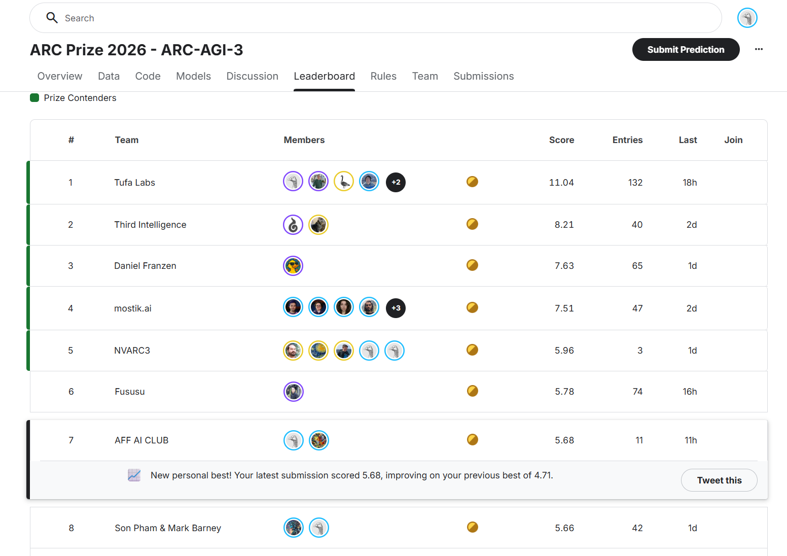
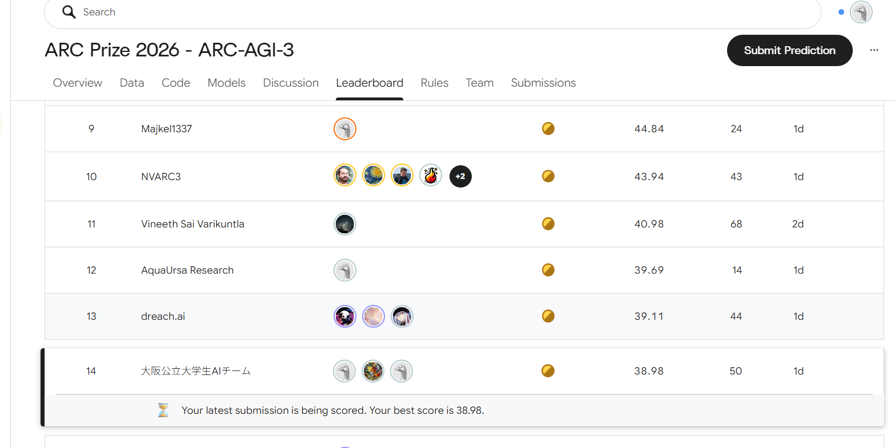
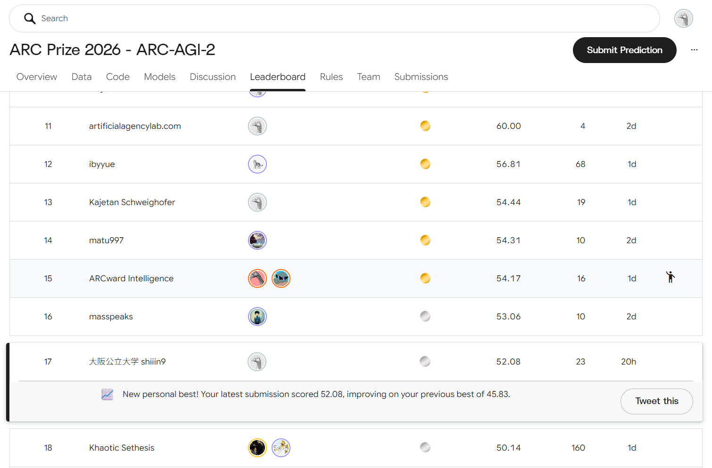

# 大阪公立大学生AIチーム — ARC Prize 2026

[日本語](#日本語) | [English](#english)

---

## 日本語

大阪公立大学の学生チームです。ARC Prize 2026 の **ARC-AGI-3** と **ARC-AGI-2** に参加しています。

### 実績

| コンペ | 実績 | 時点 |
|---|---|---|
| ARC-AGI-3 | 公開リーダーボード **全体最高7位**（5.68、当時のチーム名 AFF AI CLUB） | 2026-09-09 |
| ARC-AGI-3 | 公開リーダーボード **14位**（38.98） | 2026-10-22 |
| ARC-AGI-3 | 公開ノートブックの中でパブリックスコア **1位**（[Duck plus ours](https://www.kaggle.com/code/shiiin9/duck-plus-ours)） | 公開当時 |
| ARC-AGI-3 | 公開ノートブックの中でパブリックスコア **2位**（[31.54 in a Single Sub](https://www.kaggle.com/code/shiiin9/affectify-arc-31-54-in-a-single-sub)） | 公開当時 |
| ARC-AGI-2 | 公開リーダーボード **全体最高17位**（52.08） | 2026-10-15 |

### リーダーボード

**ARC-AGI-3 — 7位（2026-09-09）**

**ARC-AGI-3 — 14位（2026-10-22）**

**ARC-AGI-2 — 17位（2026-10-15）**

### 公開ノートブック

- [Duck plus ours](https://www.kaggle.com/code/shiiin9/duck-plus-ours)（ARC-AGI-3）
- [大阪公立大学 Affectify ARC支部🐙｜31.54 in a Single Sub](https://www.kaggle.com/code/shiiin9/affectify-arc-31-54-in-a-single-sub)（ARC-AGI-3）

### 解法について

どちらのコンペも競技期間中のため、解法は上の公開ノートブックに書いた範囲を超えては公開しません。

Claude Code と一緒に取り組んでいます。

---

## English

We are a student team from Osaka Metropolitan University, competing in **ARC-AGI-3** and **ARC-AGI-2** of ARC Prize 2026.

### Results

| Competition | Result | Date |
|---|---|---|
| ARC-AGI-3 | **best rank: 7th overall** on the public leaderboard (5.68, as team "AFF AI CLUB") | 2026-09-09 |
| ARC-AGI-3 | **14th** on the public leaderboard (38.98) | 2026-10-22 |
| ARC-AGI-3 | **#1 public notebook** by public score ([Duck plus ours](https://www.kaggle.com/code/shiiin9/duck-plus-ours)) | at the time of publication |
| ARC-AGI-3 | **#2 public notebook** by public score ([31.54 in a Single Sub](https://www.kaggle.com/code/shiiin9/affectify-arc-31-54-in-a-single-sub)) | at the time of publication |
| ARC-AGI-2 | **best rank: 17th overall** on the public leaderboard (52.08) | 2026-10-15 |

### Leaderboard

**ARC-AGI-3 — 7th (2026-09-09)**

**ARC-AGI-3 — 14th (2026-10-22)**

**ARC-AGI-2 — 17th (2026-10-15)**

### Public notebooks

- [Duck plus ours](https://www.kaggle.com/code/shiiin9/duck-plus-ours) (ARC-AGI-3)
- [31.54 in a Single Sub](https://www.kaggle.com/code/shiiin9/affectify-arc-31-54-in-a-single-sub) (ARC-AGI-3)

### About our solutions

Both competitions are still running, so we do not share anything about our solutions beyond what is in the public notebooks above.

Built together with Claude Code.
